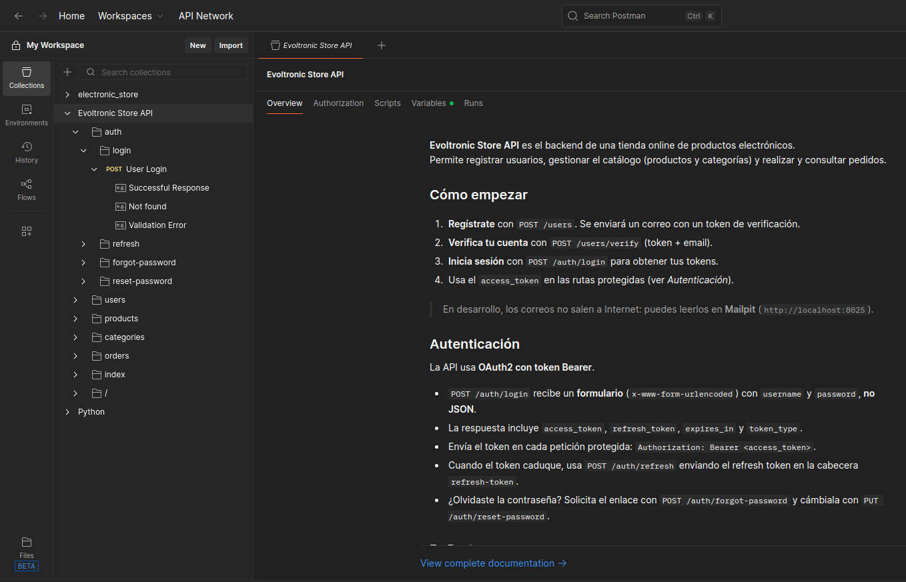

# Evoltronic Store (Backend)

📘 Also available in [Spanish](./README.es.md)

This application was developed with FastAPI. It is the backend of an online shop for electronic products and provides CRUD operations, user authentication and registration, email verification, password recovery and order management.

## Environment 🛠️

- Python 3.13
- [FastAPI](https://fastapi.tiangolo.com/) 0.115.8
- [PostgreSQL](https://www.postgresql.org/) 16.8
- [SQLAlchemy](https://www.sqlalchemy.org/) 2.0.38 + Alembic (migrations)
- [Pydantic](https://docs.pydantic.dev/) 2.10.6
- Docker 27.3.1
- [Mailpit](https://mailpit.axllent.org/) (email testing)
- API
- Tests (Pytest)
- CRUD
- Postman or Bruno
- Visual Studio Code

## Features ✨

- **User authentication**: register, log in, refresh token, email verification and password recovery.
- **Product management**: administrators can add, edit and delete products.
- **Category management**: products are organized into categories.
- **Order management**: customers can place orders and view their order details.
- **User profiles**: customers can create and update their profile and address.
- **Email sending with Mailpit**: registration and confirmation emails.

## Installation ⚙️

1.  Clone the repository to your local machine: `git clone https://github.com/nuriadevs/store-backend-fastapi.git`.
2.  Go into the project folder with `cd store-backend-fastapi`.
3.  Create your own `.env` file for the environment variables.
4.  Build and start the Docker containers with `docker-compose up --build`.
5.  Run the migrations (this also creates the admin user):

    `docker exec -it fastapi_app alembic upgrade head`

6.  Open the interactive API documentation in your web browser at [http://localhost:8000/docs](http://localhost:8000/docs).
7.  Open Mailpit to read the emails sent by the application at [http://localhost:8025](http://localhost:8025/).

> ⚠️ Prerequisites: [Docker](https://www.docker.com/) and Docker Compose. Python and PostgreSQL are only needed if you run the project outside Docker.

## 📡 API Endpoints

Authentication uses OAuth2 with a Bearer token. The **Access** column shows who can use each route: `Public` (no token), `Auth` (any logged-in user) or `Admin` (administrators only).

| Endpoint               | Method | Route                             | Access |
| ---------------------- | ------ | --------------------------------- | ------ |
| **Authentication**     |        |                                   |        |
| Login                  | POST   | `auth/login`                      | Public |
| Refresh token          | POST   | `auth/refresh`                    | Public |
| Forgot password        | POST   | `auth/forgot-password`            | Public |
| Reset password         | PUT    | `auth/reset-password`             | Public |
| **Users**              |        |                                   |        |
| Register               | POST   | `users`                           | Public |
| Verify account         | POST   | `users/verify`                    | Public |
| Authenticated user     | GET    | `users/me`                        | Auth   |
| Show                   | GET    | `users/{user_id}`                 | Admin  |
| Update username        | PUT    | `users/{user_id}`                 | Auth   |
| Destroy                | DELETE | `users/{user_id}`                 | Admin  |
| **User Profile**       |        |                                   |        |
| Create                 | POST   | `users/profile/create`            | Auth   |
| My profile             | GET    | `users/profile/me`                | Auth   |
| Update                 | PUT    | `users/profile/update`            | Auth   |
| Update address         | PATCH  | `users/profile/{user_id}/address` | Auth   |
| Show                   | GET    | `users/profile/{user_id}`         | Admin  |
| Destroy (soft delete)  | DELETE | `users/profile/{user_id}`         | Admin  |
| **Products**           |        |                                   |        |
| Index                  | GET    | `products/products/`              | Public |
| Show                   | GET    | `products/{product_id}`           | Public |
| Store                  | POST   | `products/create`                 | Admin  |
| Update                 | PUT    | `products/products/{product_id}`  | Admin  |
| Destroy                | DELETE | `products/products/{product_id}`  | Admin  |
| **Categories**         |        |                                   |        |
| Index                  | GET    | `categories/categories/`          | Auth   |
| Show                   | GET    | `categories/{category_id}`        | Auth   |
| Store                  | POST   | `categories/create`               | Admin  |
| Update                 | PATCH  | `categories/{category_id}`        | Admin  |
| Destroy                | DELETE | `categories/{category_id}`        | Admin  |
| **Orders**             |        |                                   |        |
| Store                  | POST   | `orders/create/`                  | Auth   |
| My orders              | GET    | `orders/me`                       | Auth   |
| Index                  | GET    | `orders/orders/`                  | Admin  |
| Show                   | GET    | `orders/{order_id}`               | Auth   |
| Update status          | PATCH  | `orders/{order_id}`               | Admin  |
| Destroy (pending only) | DELETE | `orders/{order_id}`               | Admin  |
| Cancel (soft delete)   | PATCH  | `orders/{order_id}/delete`        | Auth   |
| **Public**             |        |                                   |        |
| Index                  | GET    | `index/`                          | Public |
| Root                   | GET    | `/`                               | Public |

## Usage 🚀

### Postman or Bruno

If you want to explore and test the API, import the file `api_docs/evoltronic.json` into Postman or Bruno. You can also test every route from the interactive documentation at [http://localhost:8000/docs](http://localhost:8000/docs).

Log in with the **admin** user created by the migration.

### Log in

The login route uses a form (`application/x-www-form-urlencoded`), not JSON:

```bash
curl -X POST http://localhost:8000/auth/login \
  -H "Content-Type: application/x-www-form-urlencoded" \
  -d "username=Lolo&password=PassHashed_123!"

```

The response contains `access_token`, `refresh_token`, `expires_in` and `token_type`. Use the token in protected routes:

```bash
curl http://localhost:8000/users/me \
  -H "Authorization: Bearer <access_token>"

```

To get a new access token, send the refresh token in the `refresh-token` header to `POST /auth/refresh`.

### Register a new user (client)

```json
POST /users
{
  "username": "Lolo",
  "email": "lolo@example.com",
  "password": "PassHashed_123!"
}

```

### Create a new product (admin)

```json
POST /products/create
{
  "name": "Laptop",
  "description": "Laptop Samsung ultra.",
  "price": 800.50,
  "stock": 10,
  "category_id": 1
}

```

### Create a new order (client)

```json
POST /orders/create/
{
  "user_id": 1,
  "products": [
    { "product_id": 1, "quantity": 2 }
  ]
}

```

## Tests 🧪

```bash
docker-compose exec app pytest

```

## Environment Variables

Create your own `.env` file in the root of the project with the variables for the database, the security keys and the email server (Mailpit).

## Postman Demo :man_astronaut:



## Links

- [FastAPI](https://fastapi.tiangolo.com/)
- [SQLAlchemy](https://docs.sqlalchemy.org/en/20/)
- [Pydantic](https://docs.pydantic.dev/)
- [Docker](https://www.docker.com/)
- [Mailpit](https://mailpit.axllent.org/)
- [Bruno](https://www.usebruno.com/)
- [Postman](https://www.postman.com/)

## Contact

If you have any questions, send me an email.

✉️ [Email](mailto:nuriadevs@gmail.com)

## Summary

- Run the migration to test the application with an admin user.
- Don't forget to create your own `.env` file for the variables.
- The login route expects form data, not JSON.
- Emails (verification and password recovery) can be read in Mailpit at `http://localhost:8025`.
- This project is under construction... it can be improved.

## Thank you 🍀

Thank you very much for reading this project.
